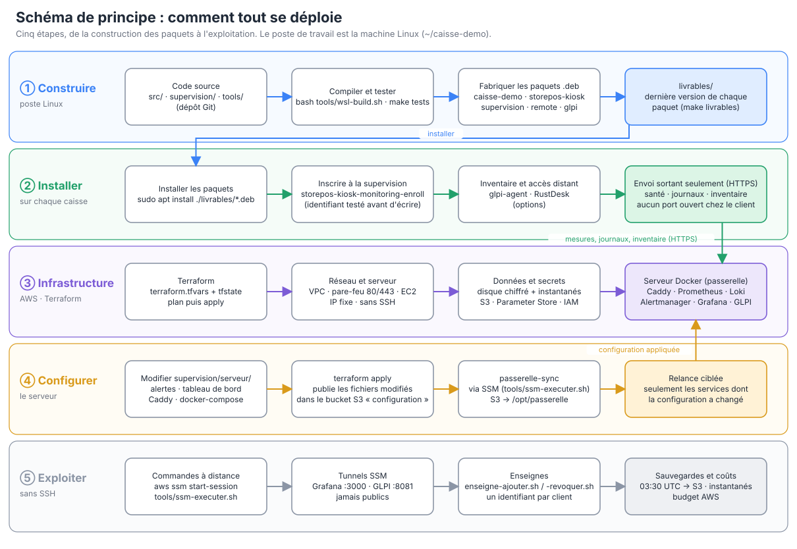
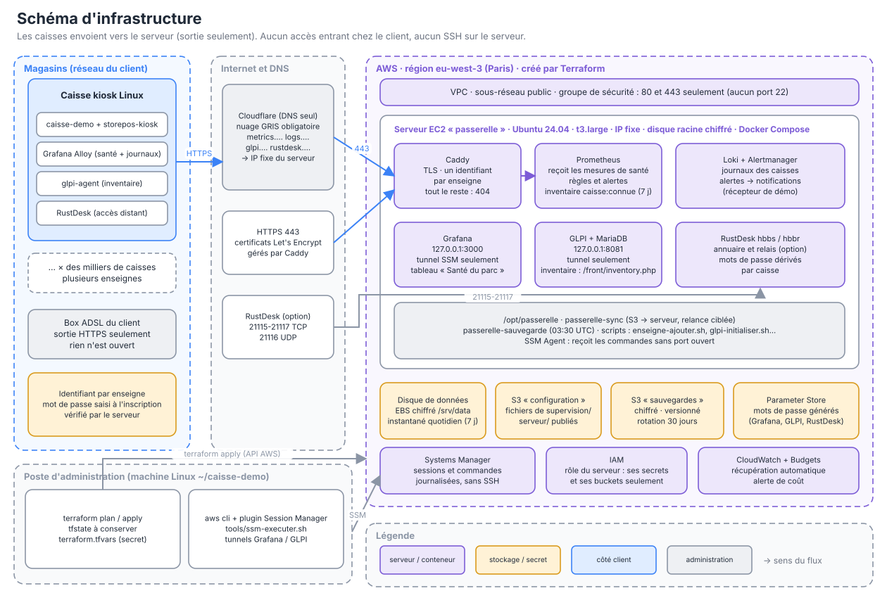

# Architecture et déploiements

Deux schémas : **comment tout se déploie** (les étapes, dans l'ordre) et **l'infrastructure** (ce qui tourne, où, et qui parle à qui).
Ce sont des fichiers SVG versionnés avec le dépôt : `docs/schemas/*.svg`. Pour les modifier, éditer `docs/schemas/generer.py` puis `python3 docs/schemas/generer.py`.

## 1. Schéma de principe des déploiements

| Étape | Ce qui se passe | Commandes |
|---|---|---|
| ① Construire | on compile, on teste, on fabrique les paquets `.deb` ; `livrables/` garde la dernière version de chacun | `make tests` · `bash tools/wsl-build.sh createDistributable` · `make agent` · `make livrables` |
| ② Installer | sur chaque caisse : installation des paquets, puis inscription (supervision, inventaire, accès distant). **Tout est sortant** : rien n'est ouvert chez le client | `sudo apt install ./livrables/*.deb` · `storepos-kiosk-monitoring-enroll` · `storepos-kiosk-glpi-enroll` |
| ③ Infrastructure | Terraform crée le serveur AWS et tout ce qui l'entoure | `terraform plan` · `terraform apply` |
| ④ Configurer | on modifie `supervision/serveur/`, Terraform publie dans S3, le serveur se resynchronise et ne relance que ce qui a changé | `terraform apply` puis `passerelle-sync` (via `tools/ssm-executer.sh`) |
| ⑤ Exploiter | sessions et commandes sans SSH, tunnels vers Grafana et GLPI, enseignes, sauvegardes | `aws ssm start-session` · `supervision/guides/AWS-COMMANDES.md` |

## 2. Schéma d'infrastructure

À retenir :

- **Aucun port ouvert chez le client** : la caisse envoie en HTTPS (443) vers le serveur, comme elle le fait déjà pour le SaaS.
- **Un seul point d'entrée public** : Caddy (ports 80 et 443). Il n'accepte que les chemins d'envoi, avec un identifiant par enseigne ; tout le reste répond 404. Grafana et GLPI ne sont **jamais** publics : on y accède par un tunnel Systems Manager.
- **Aucun SSH** : le groupe de sécurité n'ouvre pas le port 22. L'administration passe par AWS Systems Manager (authentifié par IAM, journalisé).
- **DNS en « DNS only »** (nuage gris chez Cloudflare) : le proxy empêche l'obtention des certificats et casse RustDesk.
- **Les secrets** (mot de passe Grafana, GLPI, secret RustDesk) sont générés par Terraform et lus dans Parameter Store ; ils ne sont jamais écrits dans le dépôt.
- **Sauvegardes** : archive quotidienne (03:30 UTC) vers un bucket S3 chiffré et versionné, et instantané quotidien du disque de données.

## 3. Où est quoi dans le dépôt

| Je cherche… | Dossier |
|---|---|
| le code Terraform (ce que crée AWS) | `supervision/terraform/` |
| les fichiers envoyés au serveur (Caddy, Prometheus, règles, Grafana, scripts) | `supervision/serveur/` |
| ce qui s'installe sur une caisse | `supervision/agent/`, `supervision/remote-agent/`, `supervision/glpi-agent/`, `storepos-kiosk/`, `src/` |
| les paquets prêts à installer | `livrables/` |
| les guides pas à pas et la démo | `supervision/guides/` |
| les tests | `supervision/tests/` |
